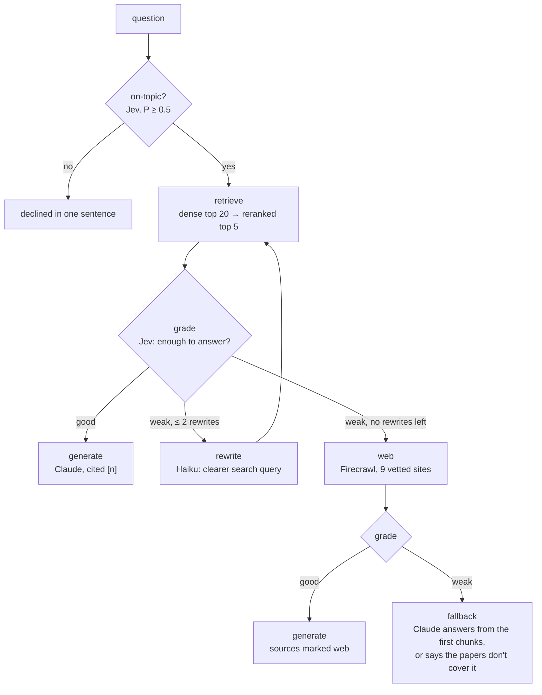

# 🧠 Neuro-RAG

**A corrective RAG assistant for hippocampus and memory neuroscience: cited answers from 52 open-access papers, and it knows when its own retrieval isn't good enough.**


-6B46C1)


[](https://github.com/amine789/NEURO-RAG-ASSISANT/actions/workflows/ci.yml)

Every claim in an answer carries a `[n]` marker pointing to a paper and page. Before answering,
the system **grades what it retrieved**; weak chunks get the question rewritten and retried, then a
search of vetted websites. Off-topic questions are declined up front, and the API returns the
exact path each question took.

> **Live:** `http://204.168.182.10/ask` (rate-limited, about 10 requests a minute per IP).
> The live server still runs row 8 (search, rerank, answer); the corrective loop is validated
> locally and not deployed yet.

---

## Results

Every change is kept only if the 50-question eval improves. Correctness is judged by Claude
against a reference answer; faithfulness checks every claim against the cited chunks.

| Version | Correctness | Faithful | Everyday questions answered | p50 / p95 |
|---|---|---|---|---|
| Row 4: baseline (dense search, top 5) | 0.67 | 0.97 | – | 1.7 s / – |
| Row 8: + cross-encoder reranker | 0.78 | 0.97 | – | 2.5 s / – |
| Rows 8 + 10: + on-topic check (CR-12 baseline, 3 runs) | 0.769 ± 0.008 | 0.95 | 0.11 | 2.9 s / 4.9 s |
| **Rows 9 + 10: + corrective loop (3 runs)** | **0.792 ± 0.000** | **0.97** | **0.89** | 4.0 s / 22.5 s |

- The loop beat its baseline **in every repeat**; the gain on correctness is small (about one question),
  the gain on **coverage** is large: everyday and out-of-corpus questions now get sourced answers
  instead of "not covered".
- All 6 off-topic questions are declined in every run, with no false declines.
- The price is latency on the web path (15–25 s); answers from the papers stay under 6 s.

Full numbers, including the runs that failed and why: [docs/specs/crag/validation.md](docs/specs/crag/validation.md).

## How it works



| Step | What | Why |
|---|---|---|
| **On-topic** | one [Jev](https://openrouter.ai) decision call (~0.3 s, ~$0.000002) | off-topic questions cost nothing downstream; chosen against Haiku, Laya and Gemma on 90 jury-labelled questions |
| **Retrieve** | dense MiniLM search in Qdrant, top 20 reranked by a cross-encoder | the reranker raised correctness 0.67 → 0.78 |
| **Grade** | Jev scores "do these 5 chunks contain the answer?" | 0.86 accuracy against a 3-model jury, 0.33 s, 25× cheaper than Haiku |
| **Rewrite** | Haiku turns casual, misspelt or non-English questions into the papers' vocabulary | the search query changes; the user's question is what gets answered |
| **Web** | Firecrawl search restricted to PubMed, PMC, Nature, Science, Cell, eLife, J Neurosci, Wikipedia | the domain is re-checked in our code too |
| **Generate** | Claude's citations API: each sentence quotes the chunk it relies on | the model never writes a marker, so a marker can't point at a source that wasn't sent |
| **Fallback** | if everything grades weak, Claude decides from the first chunks | catches false-premise questions, where the right chunks contradict the question |

Failures degrade, never crash: a failing grader, rewrite or web call counts as "weak" and the
loop moves on; only a search or answer failure returns a 503.

## Example

```bash
curl -s localhost:8000/ask -H 'Content-Type: application/json' \
     -d '{"question": "How does dopamine loss in the substantia nigra cause the motor symptoms of Parkinson'\''s disease?"}'
```

This question is neuroscience but not in the hippocampus papers, so the loop goes to the web:

```json
{
  "answer": "Motor deficits in Parkinson's disease are classically attributed to the degeneration of dopamine neurons in the pars compacta of substantia nigra, which results in marked dopamine depletion in the striatum [1]. ...",
  "sources": [{"n": 1, "pmcid": "web", "page": 0, "title": "...", "citation": "pmc.ncbi.nlm.nih.gov", "url": "https://pmc.ncbi.nlm.nih.gov/articles/..."}],
  "path": ["retrieve", "grade:weak", "rewrite", "retrieve", "grade:weak", "rewrite",
           "retrieve", "grade:weak", "web", "grade:good", "generate"],
  "used_web": true
}
```

*(Answer and path from the eval run of 2026-11-22; the source fields are shortened.)*

A question the papers cover takes the short path, `["retrieve", "grade:good", "generate"]`;
an off-topic one returns `["declined"]` with no search at all.

## Status

Built row by row: each row has a spec with numbered acceptance criteria, and tests named after them.

| # | Functionality | Status |
|---|---|---|
| 1 | Ingest and index (GROBID → chunks → Qdrant) | ✅ validated |
| 2 | Search (dense and hybrid, compared) | ✅ validated |
| 3 | Cited answer (Claude citations API) | ✅ validated |
| 4 | Eval and baseline | ✅ validated: correctness 0.67 |
| 5 | API (`POST /ask`) | ✅ validated |
| 6 | Tracing (Langfuse) | ✅ validated |
| 7 | Deployment (k3s, public URL, CI) | ✅ validated, live |
| 8 | Reranker | ✅ validated, live: 0.67 → 0.78 |
| 9 | **Corrective RAG loop** | ✅ validated: 0.769 → 0.792, everyday questions answered 0.11 → 0.89 · not deployed yet |
| 10 | Declining off-topic questions | ✅ validated: 6/6 declined, no false declines |

Plan: [docs/ROADMAP.md](docs/ROADMAP.md) · every decision, what was tried and dropped:
[docs/specs/crag/spec.md](docs/specs/crag/spec.md).

## Run it

**Needs:** Python 3.11+, Docker, and API keys for [Anthropic](https://console.anthropic.com/)
(answers, rewrites), [OpenRouter](https://openrouter.ai) (Jev: grading and the on-topic check)
and [Firecrawl](https://firecrawl.dev) (web search; free tier is enough).

```bash
git clone git@github.com:amine789/NEURO-RAG-ASSISANT.git && cd NEURO-RAG-ASSISANT
python -m venv .venv && source .venv/bin/activate
pip install -e ".[dev]"
cp .env.example .env        # then fill in ANTHROPIC_API_KEY, OPENROUTER_API_KEY, FIRECRAWL_API_KEY
```

**Build the index** (once, about 4 minutes). The papers aren't in the repo: put the PDFs in
`data/raw/<pmcid>.pdf` and the catalog in `data/candidates.csv` first.

```bash
docker compose --profile ingest up -d     # Qdrant + GROBID
python -m neuro_rag.ingest.build
```

**Serve the API** (with the loop and the on-topic check):

```bash
docker compose up -d                      # Qdrant
uvicorn neuro_rag.api.app:create_app --factory --port 8000
curl -s localhost:8000/health             # {"status":"ok"}
```

Interactive docs at http://localhost:8000/docs. Add `LANGFUSE_TRACING_ENABLED=true` to see every
state of the loop as a step in Langfuse.

## Tests and evals

| Command | What | Cost |
|---|---|---|
| `pytest -m "not integration and not llm"` | unit tests with fakes, every loop branch included | free |
| `pytest -m "integration and not llm"` | against the real Qdrant | free |
| `pytest -m llm` | against the real Claude API | about $0.01 |
| `python -m neuro_rag.eval.run --name X --rerank` | the 50 eval questions, row 8 | about $0.25 |
| `... --rerank --topic --crag` | the same with the on-topic check and the loop | about $0.30 |
| `python scripts/compare_graders.py` | the four candidate graders against the jury labels | about $0.05 |
| `python scripts/compare_topic.py` | the four candidate on-topic checks | about $0.01 |

The eval scores retrieval (right paper and page in the top 5), citations, decline behaviour,
correctness against a reference answer and faithfulness to the cited chunks; with `--crag` the
report also lists the path every question took. Add `--repeats 3` to measure the noise.

## Project layout

```
src/neuro_rag/
├── ingest/        catalog → GROBID parse → chunk → index into Qdrant
├── retrieval/     dense or hybrid search, optional reranker
├── generation/    cited answer with Claude's citations API
├── crag/          graders.py (Jev, Haiku, Laya, Gemma, on-topic) · loop.py (run_loop, rewrite, web_hits)
├── eval/          run the questions, judge, report
├── api/           FastAPI: POST /ask (check → loop), GET /health
└── config.py      models, cuts, allow-list, URLs; keys come from .env
scripts/           label_ground_truth.py, compare_graders.py, label_topic.py, compare_topic.py
eval/
├── questions.jsonl     54 questions with reference answers and expected papers
├── ground_truth/       jury labels for the graders (3 models, 47/50 unanimous)
├── topic/              90 questions + jury labels for the on-topic check
└── results/            every eval run, failed ones included
docs/
├── ROADMAP.md          product, scope, rows and status
└── specs/<row>/        spec.md (criteria, choices) + validation.md (every result)
deploy/k8s/        qdrant.yaml, api.yaml, ingress.yaml (k3s manifests)
tests/             one test per acceptance criterion
```

## Deployment

The API runs on **k3s** on one Hetzner VM:

```
internet ─:80─► Traefik (rate limit) ─► API pod ─► Qdrant pod (StatefulSet, own disk)
                                           └──► Claude, OpenRouter, Firecrawl, Langfuse
```

- **Image:** `ghcr.io/amine789/neuro-rag-api:<commit>`, pinned versions from `requirements.lock`,
  embedding models inside, no keys.
- **Keys:** a Kubernetes Secret made from `.env`, never in git or the image. Deploying the loop
  needs `OPENROUTER_API_KEY` and `FIRECRAWL_API_KEY` added to it.
- **Only port 80 is public;** Qdrant is reachable only inside the cluster.

```bash
docker build -t ghcr.io/amine789/neuro-rag-api:$(git rev-parse --short HEAD) . && docker push ghcr.io/amine789/neuro-rag-api:$(git rev-parse --short HEAD)
# set that tag in deploy/k8s/api.yaml, then:
kubectl apply -f deploy/k8s/
```

First-time setup: [docs/specs/deploy/spec.md](docs/specs/deploy/spec.md), explained command by
command in [docs/deploy-commands-explained.pdf](docs/deploy-commands-explained.pdf).

## Design choices

- **Measure before keeping.** Hybrid search, the reranker, four graders, four on-topic checks,
  the fallback: each was compared, and kept only if the numbers said so. Runs that failed are kept too.
- **Ground truth from a jury, not from the builder.** Grader and on-topic labels come from three
  frontier models from three providers, none from Anthropic, so a Claude candidate isn't graded
  against Claude's own judgement.
- **The test set stays clean.** No threshold fitted on the eval questions; the on-topic cut was
  chosen on a separate 90-question set. Where a fix was made after reading eval failures, it is
  recorded as such.
- **Cheap decisions, expensive generation.** Yes/no decisions (grade, on-topic) go to a decision
  model at about $0.00004 a call; only writing goes to an LLM.
- **Claude's citations, not model-written markers.** A marker can only point at a chunk that was
  sent, and carries the exact text it relies on.
- **Kept simple on purpose.** A plain function for the loop (no LangGraph), sync code, one process.

## Licence of the papers

All 52 papers are open access from PubMed Central; each answer links to the paper's PMC page.
