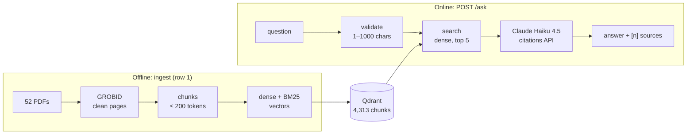

# 🧠 Neuro-RAG

**Cited answers about hippocampus and memory neuroscience, from 52 open-access papers.**

Ask a question over HTTP; get a short answer where every claim carries a
`[n]` marker that points to a paper and page. When the papers don't cover it,
it says so instead of guessing.


---

## Example

```bash
curl -s localhost:8000/ask -H 'Content-Type: application/json' \
     -d '{"question": "How does m6A RNA methylation support hippocampus-dependent learning and memory?"}'
```

```json
{
  "answer": "mRNA m6A methylation facilitates learning and memory formation in the mouse hippocampus mainly by promoting translation from target transcripts upon neuronal stimuli, mediated through its binding protein Ythdf1 [1]. Upon stimulation, more binding of Ythdf1 to its m6A-methylated targets occurs to facilitate translation as well as to help stabilize them [1]. Additionally, depletion of Ythdf1 impairs basal transmission and LTP (long-term potentiation) of hippocampal synapses [1].",
  "sources": [
    {
      "n": 1,
      "pmcid": "PMC6226095",
      "page": 6,
      "title": "m6A facilitates hippocampus-dependent learning and memory through Ythdf1",
      "citation": "Nature. Author manuscript; Available in PMC 2019 Apr 30.",
      "url": "https://pmc.ncbi.nlm.nih.gov/articles/PMC6226095/"
    }
  ]
}
```

*(A real response from the running server, 2026-11-15.)*

## How it works



1. **Ingest.** GROBID turns each PDF into clean text (abstract, body, figure
   captions; no references or headers). Text is cut into chunks of up to 200
   tokens, each knowing its paper and page, and stored in Qdrant with a dense
   vector (MiniLM, 384 numbers) and a BM25 vector.
2. **Search.** The question is embedded and the 5 nearest chunks come back.
   Dense and hybrid (dense + BM25, fused by rank) were compared on the eval
   questions; dense found the right page for 24/36 against 23/36, so it is
   the default.
3. **Answer.** Each chunk goes to Claude as a *document* with citations on.
   Claude's own citations say which chunk each sentence relies on, quoting it
   exactly, and the code turns them into `[n]` markers. The model never
   writes a marker itself, so a marker can't point at a source that wasn't
   sent.
4. **API.** FastAPI checks the question (empty or over 1000 characters is a
   422) and returns a fixed 503 sentence if Qdrant or Claude fails, never the
   internal error.

## Status

Built row by row; each row has a spec with numbered acceptance criteria, and
tests named after them.

| # | Functionality | Status |
|---|---|---|
| 1 | Ingest and index | ✅ validated |
| 2 | Search (dense and hybrid, compared) | ✅ validated |
| 3 | Cited answer | ✅ validated |
| 4 | Eval and baseline score | 🔨 built; baseline run pending |
| 5 | API (`POST /ask`) | ✅ validated |
| 6 | Tracing (Langfuse) | ✅ validated |
| 7 | Deployment (Kubernetes, public URL) | ⏳ planned |
| 8–12 | Better search, question rewriting, "not in the papers", web search, declining | ⏳ planned, each kept only if the eval improves |

The full plan is in [docs/ROADMAP.md](docs/ROADMAP.md).

## Run it

**Needs:** Python 3.11+, Docker, an [Anthropic API key](https://console.anthropic.com/).

```bash
git clone git@github.com:amine789/NEURO-RAG-ASSISANT.git && cd NEURO-RAG-ASSISANT
python -m venv .venv && source .venv/bin/activate
pip install -e ".[dev]"
cp .env.example .env        # then put your ANTHROPIC_API_KEY in it
```

**Build the index** (once, about 4 minutes). The papers aren't in the repo:
put the PDFs in `data/raw/<pmcid>.pdf` and the catalog in
`data/candidates.csv` first.

```bash
docker compose --profile ingest up -d     # Qdrant + GROBID
python -m neuro_rag.ingest.build
```

**Ask from the command line:**

```bash
docker compose up -d                      # Qdrant
python -m neuro_rag.retrieval.search "How do place cells encode location?"
python -m neuro_rag.generation.answer "How do place cells encode location?"
```

**Serve the API:**

```bash
uvicorn neuro_rag.api.app:create_app --factory --port 8000
curl -s localhost:8000/health             # {"status":"ok"}
```

Interactive API docs are at http://localhost:8000/docs.

## Tests

| Command | What | Cost |
|---|---|---|
| `pytest -m "not integration and not llm"` | unit tests with fakes | free |
| `pytest -m "integration and not llm"` | against the real Qdrant | free |
| `pytest -m llm` | against the real Claude API | about $0.01 |
| `python -m neuro_rag.eval.run --name baseline` | the 50 eval questions, judged | about $0.25 |

The eval scores retrieval (right paper and page in the top 5), citations,
"not covered" behaviour, and, with Claude as a judge, correctness against a
reference answer and faithfulness to the cited chunks.

## Project layout

```
src/neuro_rag/
├── ingest/        catalog → GROBID parse → chunk → index into Qdrant
├── retrieval/     search: dense or hybrid, top k
├── generation/    cited answer with Claude's citations API
├── eval/          run the questions, judge, report
├── api/           FastAPI app: POST /ask, GET /health
└── config.py      models, paths, URLs; keys come from .env
docs/
├── ROADMAP.md     product, scope, the 12 rows and their status
└── specs/<row>/   spec.md (criteria) + validation.md (how checked, results)
eval/questions.jsonl   54 questions with reference answers and expected papers
tests/             one test per acceptance criterion
```

## Design choices

- **Claude's citations, not model-written markers.** A marker can only point
  at a chunk that was sent, and carries the exact text it relies on.
- **One source per paper and page,** not per chunk: the reader looks up a page.
- **Measure before keeping.** Hybrid search, a reranker, question rewriting:
  each is compared on the eval and kept only if it helps.
- **Say "not covered" rather than guess.** In a science domain a confident
  wrong answer costs more than "the papers don't cover this".
- **Kept simple on purpose.** Sync code, one process, no auth yet; async, client
  keys and rate limits come after row 12.

## Licence of the papers

All 52 papers are open access from PubMed Central; each answer links to the
paper's PMC page.
